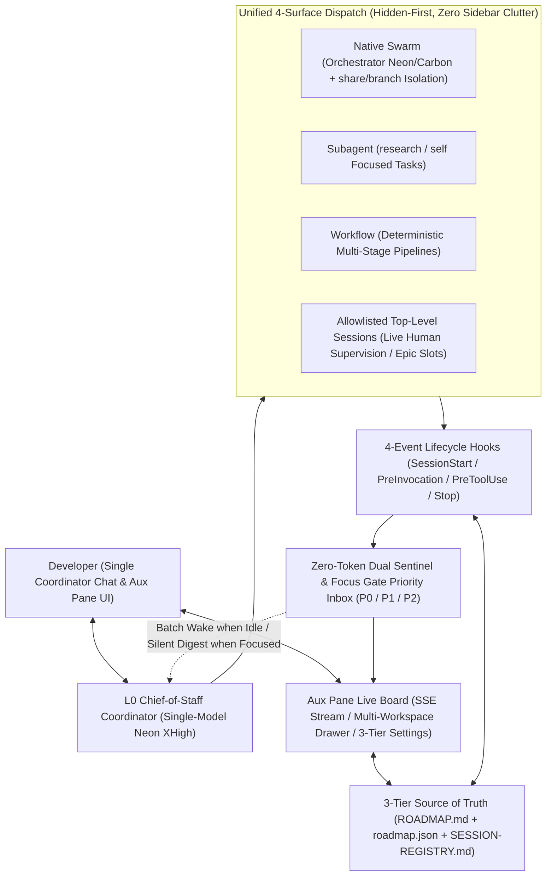

# Control Tower for Google Antigravity

**[简体中文](README.md) | [English](README.en.md)**

[](https://github.com/Hi-Jiajun/agy-control-tower/actions/workflows/ci.yml)
[](CHANGELOG.md)
[](LICENSE)
[](package.json)
[](plugin/plugin.json)

A universal **Chief-of-Staff Control Tower** native plugin for **Google Antigravity**. It establishes a lightweight, persistent coordinator conversation in any workspace — keeping your main thread free of heavy code/log dumps while orchestrating hidden execution surfaces (native `swarm`, `invoke_subagent`, `run_workflow`), a zero-token background sentinel with Foreground Focus Gate, single-slot exclusive resource leases, a 3-tier hybrid project roadmap DAG, and a native Antigravity real-time SSE Aux Pane dashboard.

---

## Why Control Tower?

Long-running or multi-agent workflows in IDE coding agents often hit five recurring bottlenecks:

1. **Coordinator Context Rot**: Mixing architectural planning with massive file reads and build logs causes rapid context compactions and forgotten constraints.
2. **Sidebar Session Sprawl**: Spawning top-level conversations for every subtask floods the left sidebar and makes progress tracking painful.
3. **Parallel Edit & Hardware Collisions**: Concurrent agents overwrite overlapping files or contend for exclusive hardware/ports without ownership boundaries.
4. **Foreground Interruptions**: Background completion pings interrupt the developer mid-thought during active planning turns.
5. **Suboptimal Model Routing & Cache Thrashing**: Dual-layer model switches on short coordinator turns waste cold-input tokens, while parallel workers lack explicit comfort-zone model assignments.

**Control Tower** solves these with **4-event targeted lifecycle hooks + a zero-dependency real-time SSE Aux Pane Sidecar + an on-demand Chief-of-Staff Skill**, while staying **100% silent in workspaces that do not use it** (`components.rules === 0`, zero global always-on rules).

---

## Architecture Overview



---

## 3-Minute Quick Start

### 1. Prerequisites
- **Google Antigravity** (IDE & official `agy` CLI)
- **Node.js `>= 20.0.0`** (100% zero third-party npm dependencies — no `npm install` needed! Node `>= 22` recommended for running the optional headless browser CDP UI smoke suite)
- Runs on **Linux, macOS, and Windows**

### 2. Install the Plugin

```bash
git clone https://github.com/Hi-Jiajun/agy-control-tower.git
cd agy-control-tower

# Optional: validate the pure ./plugin bundle in strict mode
agy plugin validate --strict ./plugin

# Install via the official Antigravity CLI
agy plugin install ./plugin
```

### 3. Launch Your First Coordinator Session

1. Open the **Control Tower** panel in the Antigravity right-hand **Aux Pane** and initialize your workspace in one click from the onboarding screen:
   - **Standard Workspace Mode (Recommended)**: Creates `.agents/SESSION-REGISTRY.md` inside your project;
   - **Zero-Intrusion Managed Mode (Clean Repo)**: Stores state under `<appData>/plugin_data/control-tower/`, leaving **zero untracked files** in shared team Git repositories (you can also switch anytime under **Settings -> Current Workspace**).
2. Start a new coordinator conversation (recommended L0 model: **`Gemini 4 Neon (XHigh)`**) and click one of the starter prompts or send:
   > `Activate the control-tower skill, perform a read-only cold-start audit of this workspace, and initialize or verify SESSION-REGISTRY.md.`

---

## Aux Pane Live Dashboard Tour

Crafted in Google Antigravity's native monochrome design language with direct host theme token binding, a compact 2-row frosted sticky header (`<= 88px`), GPU-accelerated sliding tab & segmented indicators, grouped native `<select>` model pickers, and `stateSig` zero-payload silent poll short-circuiting:

| Tab | What You Can Do in One Click |
| --- | --- |
| **Overview (`总览`)** | **Controller Health Card** (live online indicator, compaction counter, jump to chat, 1-click `/learn`, pre-authorized handover spawn); **Single-Slot Lease** (collapses quietly to 1 line when `IDLE`, expands with 1-click release when held); **Zero-Token Sentinel Inbox** (`P0/P1/P2` triage, auto-muted when `0` unread, batch deliver to coordinator when active) |
| **Surfaces (`执行面`)** | Unified 2x2 Execution Surfaces grid (Swarm / Subagent / Workflow / Top-Level), live Native Swarm roster with worktree isolation badges & 1-click `waiting` member cleanup, allowlisted direct dispatch form, and inline bare-ID transcript tail probe |
| **Roadmap (`路线图`)** | Optional `L1 ROADMAP.md` north-star editor + `L2 roadmap.json` dependency tree: semantic `READY` / `ACTIVE` / `BLOCKED` status borders, cycle rejection, parallel file ownership overlap alerts, `.agents/handoffs/` inline preview, and 1-click hidden-surface dispatch |
| **Queue (`队列`)** | Collapsible task queue manager with curated `L1-L4` model route presets and WebView-safe inline 2-step delete confirmation |
| **Registry (`台账`)** | 6 ready-to-copy orchestration & handover prompt templates above a SHA-256 optimistic-locked raw `SESSION-REGISTRY.md` editor |
| **Settings (`设置`)** | Strictly isolated **Plugin / Global / Workspace** 3-tier configuration, 13 grouped `<select>` model pickers with dynamic `customAllowedModels` sync, online `model-routing.md` & `templates.md` overrides, and redacted flight-recorder diagnostics |

---

## Typical Daily Workflows

1. **Read-Only Cold Start**: Run the starter prompt in a fresh conversation -> the coordinator audits repo rules & exclusive hardware constraints, registers its `conversationId`, and reports a concise workspace summary.
2. **Hidden-Surface Feature Dispatch**: Ask the coordinator to build or debug a module -> it recommends the optimal hidden surface via `ask_question` (e.g., native `swarm` with `workspace: "share"` + `Orchestrator (Neon Extra High)`), keeping your left sidebar completely clean.
3. **Uninterrupted Deep Planning + Milestone Unlocks**: Keep discussing architecture in the foreground while the zero-token Sentinel quietly files background completions into the Inbox; review & mark `W1` done in the Roadmap tab to automatically unlock downstream `W2`.
4. **Smart `/learn` & Seamless Handover**: Distill reusable repo rules via `learning_proposal.md` at milestones, and spawn a pre-authorized successor coordinator in one click once compactions reach the configurable threshold (default `5`).

---

## Key Capabilities

- **Hidden-Surface-First Dispatch & 4-Surface Navigator**: Routes 80%+ of coding, review, and verification tasks to native `swarm` (with `share` / `branch` worktree isolation and zero-cost `waiting` hibernation), `invoke_subagent`, and `run_workflow`.
- **Zero-Token Sentinel & Foreground Focus Gate**: Sidecar timer + throttled Hook sweeps detect worker errors, stuck sessions, and high compactions with **0 LLM tokens**, filing events into `inbox.json` (`P0` blocker / `P1` milestone / `P2` routine) and deferring preemptive wakeups while you are actively chatting.
- **`PreToolUse` Cross-Tool Registry Guard & Dual-Evidence Handover**: Protects `SESSION-REGISTRY.md` across both built-in `write_file` / `edit_file` and MCP batch edit tools (`apply_edits` / `call_mcp_tool`), while seamlessly authorizing legitimate controller handovers.
- **3-Tier Hybrid Roadmap DAG**: Combines `ROADMAP.md` (north-star invariants), `roadmap.json` (DAG dependencies, file ownership conflict checks, ready-node unlocking), and `SESSION-REGISTRY.md` with one-click hidden-surface dispatch from the board.
- **Smart Dual-Trigger `/learn` Loop**: Workers never mutate `AGENTS.md` directly; instead they attach optional 1-3 line candidate lessons on `[CT_REPORT:DONE]`, and the coordinator proposes structured `/learn` updates at milestones or user corrections (with 15-minute anti-spam throttling).
- **Defense-in-Depth Local Security**: Loopback-only (`127.0.0.1`) HTTP server with `crypto.timingSafeEqual` token auth, `Host` DNS-rebinding protection, strict URL-parsed `Origin` & `Sec-Fetch-Site: cross-site` CSRF blocking, multi-level symlink escape prevention, and automatic Linux/macOS/Windows path & token redaction in rotating flight logs.

---

## Empirical L0-L4 Comfort-Zone Model Routing

Calibrated against real multi-day session telemetry (prompt-cache hit rate, cold-input overhead, and edit mismatch rate). All tiers are customizable globally or per-workspace under the **Settings** tab (including a **Custom Allowlist** mode that dynamically syncs custom model IDs across all 13 model pickers):

| Tier | Typical Workload | Default Model | Explicit CLI / Swarm ID | Empirical Rationale |
| --- | --- | --- | --- | --- |
| **L0 Coordinator** | Triage, dispatch decisions, lease & registry updates, handover | Single-model **`Gemini 4 Neon (XHigh)`** | `gemini-4-neon-xhigh` | Eliminates 40%-63% dual-model switch cold-input overhead on short interactive turns |
| **L1 Light Scan** | Read-only search fan-out, log triage, compliance checks | Single-model **`Gemini 4 Hydrogen (XHigh)`** | `gemini-4-hydrogen-xhigh` | Fast single-pass execution with highest quota efficiency |
| **L2 Standard Dev** | Multi-file features, bug fixes, unit tests, primary Swarm workers | **`Orchestrator (Neon Extra High)`** | `gemini-pro-orchestrator-neon` | Deep upfront planning + fast execution; 94%+ cache hit & <1% edit mismatch in Swarm |
| **L3 Deep Debug** | Cross-layer crashes, subtle race conditions, architecture audits | **`Orchestrator (Carbon)`** | `gemini-pro-orchestrator` | Flagship `Carbon (High)` reasoning paired with high-speed execution |
| **L4 Integration** | Multi-branch merge verification, full release gates | **`Orchestrator (Neon Extra High)`** | `gemini-pro-orchestrator-neon` | Balances cross-module synthesis with fast verification loops |

---

## Development, Quality Gates & Contributing

Contributions are welcome! Please read [CONTRIBUTING.md](CONTRIBUTING.md) and [SECURITY.md](SECURITY.md) before submitting a PR.

```bash
# Install cross-platform local pre-commit hygiene & version-sync git hooks
npm run setup-hooks

# Run cross-platform CI suite (31 unit tests + 16 replays + 17 skill evals + offline validator; no agy CLI needed)
npm run ci

# Run full local 4D release gate (adds 36-check real headless Chrome CDP UI smoke + official agy --strict validation)
npm run gate

# Check live local installation health or manage rollback snapshots
npm run doctor
npm run release:list
```

## License

Released under the [MIT License](LICENSE).
