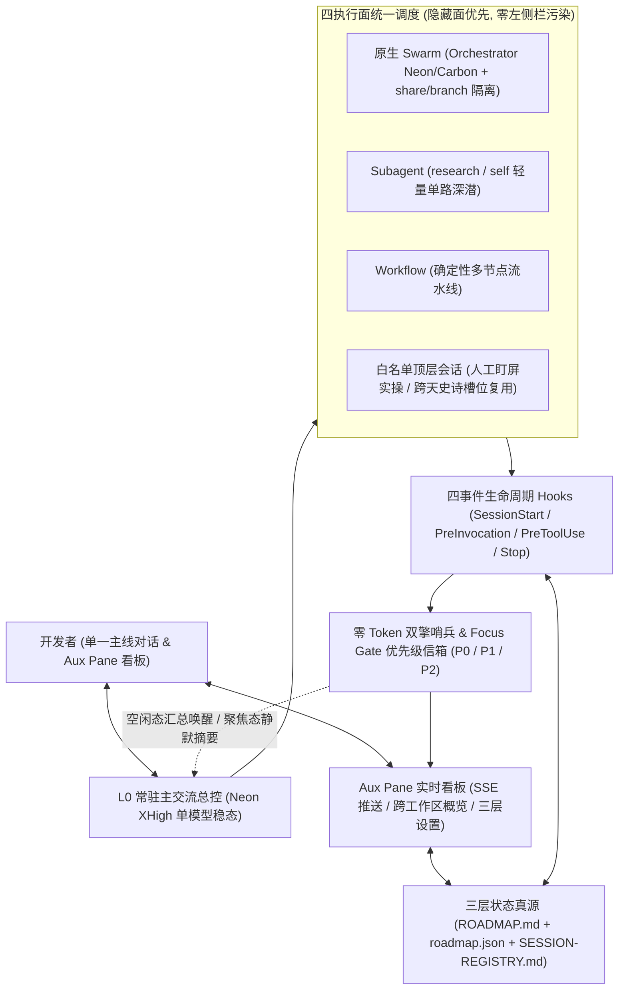

# Control Tower for Google Antigravity

**[简体中文](README.md) | [English](README.en.md)**

[](https://github.com/Hi-Jiajun/agy-control-tower/actions/workflows/ci.yml)
[](CHANGELOG.md)
[](LICENSE)
[](package.json)
[](plugin/plugin.json)

面向 **Google Antigravity** 的通用常驻主交流总控（Chief-of-Staff）原生插件。它在任意工作区建立一条**轻量、常驻、不亲自啃大代码与大日志**的主对话指挥线，统一统筹需求拆解、隐藏执行面调度（原生 `swarm` / `invoke_subagent` / `run_workflow`）、冷热解耦零 Token 后台哨兵、独占资源单锁、三层长期路线图 DAG 与 Aux Pane 实时可视化总控看板。

---

## 为什么需要 Control Tower？

在复杂或多天跨度的 Antigravity 项目中，单会话一竿子到底或多窗口混跑往往会遇到五大痛点：

1. **主对话上下文迅速膨胀老化**：主会话既聊架构又亲自读几千行日志改代码，几轮压缩后开始遗忘红线。
2. **左侧顶层会话栏无限膨胀**：频繁新开顶层窗口导致会话列表失控，难以追踪哪个窗口在干什么。
3. **并行子代理互踩文件或抢占独占设备**：多个任务同时改同一批文件或争抢真机/测试端口，缺乏所有权与租约门禁。
4. **后台完成通知打断前台深度讨论**：用户正与主会话推演方案时，后台任务抢占回合插嘴打断思路。
5. **模型错配与频繁切层损耗缓存**：短对话总控频繁跨模型切层浪费冷输入，而并发 worker 又缺乏显式舒适区配模。

**Control Tower** 通过「四事件定向感知 Hooks + 零依赖实时 SSE Aux Pane 看板 + 按需加载总控规程 Skill」提供开箱即用的工程化闭环，且对未启用控制塔的普通工作区保持 **100% 静音零干扰**（`components.rules === 0`）。

---

## 系统架构总览



---

## 3 分钟快速开始

### 1. 环境要求
- **Google Antigravity**（IDE 客户端与官方 `agy` CLI）
- **Node.js `>= 20.0.0`**（纯零第三方 npm 依赖，克隆即装，无需 `npm install`；运行仓根无头浏览器 UI 冒烟门禁推荐 Node `>= 22`）
- 支持 **Linux / macOS / Windows**

### 2. 安装插件

```bash
git clone https://github.com/Hi-Jiajun/agy-control-tower.git
cd agy-control-tower

# 可选：使用官方严格模式校验纯净插件包
agy plugin validate --strict ./plugin

# 使用 Antigravity 官方 CLI 安装插件
agy plugin install ./plugin
```

> **提示**：若早期手动配置过旧版散装全局技能 `$HOME/.gemini/config/skills/control-tower`，安装前可先运行 `bash scripts/cleanup-legacy-skill.sh --status` 检查并清理，避免同名技能双重发现。

### 3. 在任意项目启动总控与看板

1. 在 Antigravity 右侧辅助面板（Aux Pane）打开 **Control Tower** 看板。
2. 新建一个总控会话（默认推荐模型 **`Gemini 4 Neon (XHigh)`**），点击插件推荐提示词或直接发送：
   > `启用 control-tower 总控规程，对当前工作区执行纯只读冷启动盘点并初始化或核对 SESSION-REGISTRY.md。`
3. **团队仓库零侵入托管模式（可选）**：如果不希望在业务 Git 仓库中生成 `.agents/SESSION-REGISTRY.md`，可在看板「设置中心 -> 工作区设置」将台账存储位置切换为 **`PLUGIN_DATA 零侵入托管`**（自动存储于 `<appData>/plugin_data/control-tower/`，对业务仓零文件改动）。

---

## 核心特性一览

- **隐藏执行面优先与四执行面统一导航**：80%+ 常规编码与验证优先走原生 `swarm`（支持 `workspace: "share" | "branch"` 工作树隔离与休眠唤醒）、`invoke_subagent` 与 `run_workflow`，彻底告别左侧会话栏爆炸；看板一屏聚合全部顶层与隐藏任务。
- **冷热解耦零 Token 哨兵与焦点防打扰门禁（Focus Gate）**：Sidecar 后台与 Hook 节流双引擎 0 Token 巡检报错、卡死（Stuck）与高压缩老化，分级沉淀至 `inbox.json`（`P0` 紧急阻塞 / `P1` 阶段收口 / `P2` 例行）；用户前台连续对话期间自动暂缓抢占式唤醒。
- **`PreToolUse` 全通道台账写保护与双证换届闭环**：同时拦截内置 `write_file` / `edit_file` 与 MCP 批量编辑工具（`apply_edits` / `call_mcp_tool`），防止并行 worker 误改台账；总控累计压缩达阈值（默认 `5` 次，可调可忽略）时支持看板一键生成预填交接卡并预授权新总控平滑接班。
- **三层混合路线图 DAG 与文件所有权冲突预警**：大型项目可一键开启 `L1 ROADMAP.md` + `L2 roadmap.json` + `L3 SESSION-REGISTRY.md`，自动计算就绪（`ready`）分支、拦截循环依赖与并行文件所有权（Ownership）重叠，并支持看板一键派单与 `[CT_REPORT:DONE]` 自动联动。
- **智能双触发 `/learn` 经验沉淀闭环**：专职会话严禁私改 `AGENTS.md` 或全局规则，仅在完工回执提炼可选经验候选；总控在阶段收口或识别纠偏信号（带 15 分钟冷却防刷屏）时按原生 `/learn` 规范生成审批提案。
- **本地纵深安全防护**：Sidecar 仅监听 `127.0.0.1`，内置 `timingSafeEqual` 恒定时间鉴权、`Host` 防 DNS 重绑定校验、`Origin` 主机名精确解析与 `Sec-Fetch-Site: cross-site` 拦截；飞行日志自动脱敏三端个人路径、内网 IP 与敏感凭据。

---

## L0-L4 实证舒适区模型路由默认表

基于大规模真实会话遥测（缓存命中率、跨模型切层冷输入开销与编辑失配率），内置默认采用**「全最高思考档位 + 动静分流」**策略（可在看板「设置中心」按全局或单工作区自由修改，或切换为「自定义白名单」接入其他模型）：

| 层级 | 典型场景 | 默认首选模型 | CLI / Swarm 显式 ID | 设计依据 |
| --- | --- | --- | --- | --- |
| **L0 常驻总控** | 需求拆解、派单裁决、资源锁与台账维护、换届收口 | 单模型 **`Gemini 4 Neon (XHigh)`** | `gemini-4-neon-xhigh` | 短对话多轮交互零切层冷输入损耗、无 `[plan review]` 额外往返，长程稳健性最高 |
| **L1 轻扫归档** | 多源只读检索、大日志筛查、合规审计、文档归档 | 单模型 **`Gemini 4 Hydrogen (XHigh)`** | `gemini-4-hydrogen-xhigh` | 单层极速直出，配额效率最优 |
| **L2 常规开发** | 多文件功能实现、子系统排障、单测补齐、Swarm 主力 worker | **`Orchestrator (Neon Extra High)`** | `gemini-pro-orchestrator-neon` | 规划写透后高速执行；原生 `swarm` 下稳定高缓存命中且低编辑失配率 |
| **L3 疑难攻坚** | 跨层死坑根因定位、复杂并发竞态、核心架构重构审查 | **`Orchestrator (Carbon)`** | `gemini-pro-orchestrator` | 旗舰 `Carbon (High)` 深度规划推理 + 高速执行落地（无 `Carbon` 时平滑替补 `Neon`） |
| **L4 合流发布** | 多分支集成验收、全量门禁复核、里程碑发布 | **`Orchestrator (Neon Extra High)`** | `gemini-pro-orchestrator-neon` | 兼顾全局合流复核深度与多步验证执行速度 |

---

## 仓库目录结构

```text
control-tower/
├── .github/                         # 多系统 GitHub Actions CI (Ubuntu/macOS/Windows) 与 Issue/PR 模板
├── AGENTS.md                        # 源码仓开发协作规范（不打入 ./plugin/ 安装包）
├── CHANGELOG.md                     # 版本演进记录（Keep a Changelog）
├── CONTRIBUTING.md                  # 开源贡献者开发与门禁指南
├── LICENSE                          # MIT 开源许可证
├── README.md / README.en.md         # 中英双语说明文档
├── SECURITY.md                      # 安全威胁模型与漏洞披露策略
├── docs/ARCHITECTURE-ROADMAP.md     # 架构不变量与演进蓝图
├── package.json                     # 仓根工程脚本清单（零第三方依赖）
├── plugin/                          # Antigravity 官方标准原生插件纯净包
│   ├── plugin.json                  # 插件清单与唯一 SemVer 版本真源
│   ├── hooks.json                   # 四事件钩子配置 -> node ./scripts/ct-hook.mjs
│   ├── README.md & LICENSE          # 随包说明与许可证
│   ├── assets/logo.svg              # 插件矢量图标
│   ├── lib/                         # 零依赖共享核心 (paths/logger/inbox/roadmap/registry/settings/transcript)
│   ├── scripts/ct-hook.mjs          # 四事件统一生命周期钩子入口
│   ├── sidecars/tower/              # Aux Pane 实时总控看板 (SSE 推送 / 经典单包兼容网关 / 模块化视图)
│   └── skills/control-tower/        # 总控核心规程、路由手册与标准文本模板
├── scripts/                         # 五环自演化研发与运维工具链
│   ├── ct-validate-offline.mjs      # 无 agy CLI 环境的离线插件包严格校验器
│   ├── ct-precommit-check.mjs       # 跨平台隐私脱敏、零间隔号与版本一致性门禁
│   ├── ct-ui-smoke.mjs              # 零依赖无头浏览器 CDP 窄栏/宽栏亮暗双主题 UI 冒烟
│   ├── ct-skill-eval.mjs            # 17 项黄金行为契约评测套件
│   ├── ct-replay.mjs                # 脱敏事故轨迹沙箱回放与冻结器
│   ├── ct-miner.mjs                 # 只读遥测与黑匣子聚类复盘工具
│   ├── ct-doctor.mjs                # 实装健康探针（版本、残留、进程与快照体检）
│   └── ct-release.mjs               # 发布前自动快照、安全实装与一键秒回滚
└── tests/                           # 基于内置 node:test 的 30 项单测与 16 份脱敏事故回放库
```

---

## 升级、体检、快照回滚与卸载

```bash
# 查看当前本机实装健康状态（版本对齐、旧散装残留、24h 黑匣子与可回滚快照）
npm run doctor

# 自动备份旧版快照（保留最近 3 份）并安全实装当前源码版本
node scripts/ct-release.mjs install --confirm

# 查看历史快照并在需要时一键秒级回滚
npm run release:list
npm run release:rollback

# 使用官方 CLI 卸载插件
agy plugin uninstall control-tower
```

---

## 研发验证与开源贡献

欢迎提交 Issue 或 Pull Request！完整开发约束请参阅 [CONTRIBUTING.md](CONTRIBUTING.md) 与 [SECURITY.md](SECURITY.md)。

```bash
# 启用跨平台本地 pre-commit 自动脱敏与包边界检查钩子
npm run setup-hooks

# 跨平台 CI 核心门禁（无需本机安装 agy CLI）
npm run ci

# 完整本地四维发布门禁（含无头 Chrome UI 冒烟与官方 agy strict 校验）
npm run gate
```

## 许可证

本项目基于 [MIT License](LICENSE) 开源。
